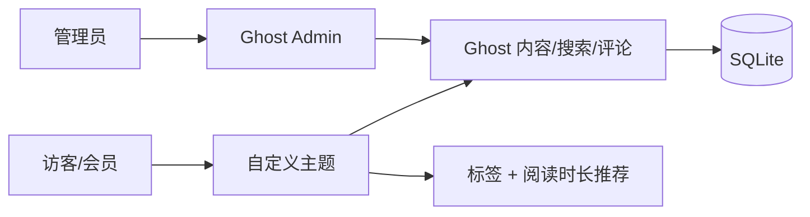
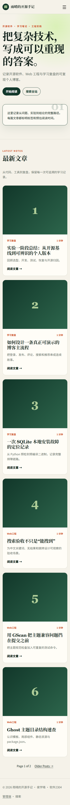
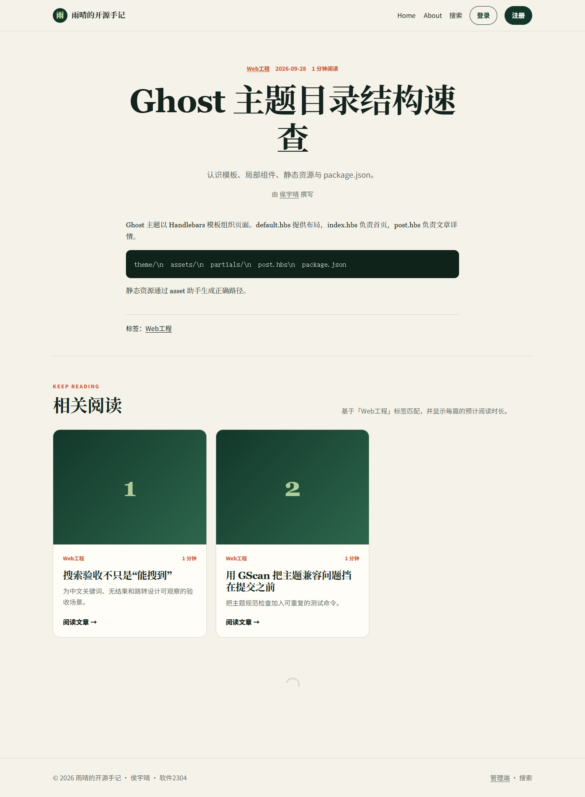

# 雨晴的开源手记

> 基于 Ghost 6.45.0 的可注册、可写作、可评论、可搜索个人博客，并通过按标签与阅读时长生成相关推荐。

- 学生：侯宇晴
- 学号：23120506154
- 班级：软件2304
- 课程实验：实验1 - 开源个人博客系统二次开发

## 功能

- Ghost Admin 创建、编辑和发布文章，按标签浏览。
- Portal 会员注册/登录和 Ghost 会员评论。
- Ghost 原生搜索，支持中文关键词、无结果状态和跳转。
- 独立中文响应式主题：首页、列表卡片、文章详情、标签页、作者页和错误页。
- 自主功能：相同主标签的服务端相关推荐，排除当前文章，显示阅读时长和可理解的失败状态。
- 8 篇脱敏演示文章、3 个标签和 2 个本地演示会员。

## 技术栈与架构

Ghost 6.45.0 + Node.js 22.14.0 + SQLite 3.44.2 + Handlebars + CSS + 少量原生 JavaScript。详细架构、目录职责和请求路径见 [`docs/architecture.md`](docs/architecture.md)。



## 环境要求

- Windows 11（当前验证），macOS/Linux 可按 Ghost 本地安装文档执行。
- Node.js 22.13.1 或更高的 22.x；本项目验证为 22.14.0。
- Ghost-CLI 1.30.1，Ghost 6.45.0，Git 2.40+。
- Python 3 + setuptools（Node 22 下的 SQLite 安装检查）。

```powershell
git --version
node --version
npm --version
ghost --version
```

## 当前工作区一键启停

```powershell
./scripts/Start-Ghost.ps1
./scripts/Stop-Ghost.ps1
```

启动后访问 http://localhost:2368/，管理端为 http://localhost:2368/ghost/。本机已初始化的演示管理员密码只在交付时单独提供，仓库不保存凭据。

## 全新目录冷启动

```powershell
npm install -g ghost-cli@1.30.1
New-Item -ItemType Directory runtime
Set-Location runtime
ghost install 6.45.0 --local --no-start
ghost start
```

1. 访问 `/ghost/` 创建新的本地管理员，不复用仓库外的密码。
2. 按 [`backup/README.md`](backup/README.md) 导入脱敏内容。
3. 上传 `theme/oss-blog-theme/dist/oss-blog-theme.zip`，或在开发环境将 `runtime/content/themes/oss-blog-theme` 链接到主题源码。
4. 在 Settings 中保持 `members_signup_access=all` 和 `comments_enabled=all`。
5. 新建两个测试会员，再执行下方测试。

Windows 如遇 sqlite3 预编译包下载失败，请查看 [`docs/baseline.md`](docs/baseline.md) 的实际故障和已验证的官方二进制哈希。

## 主题开发、测试与打包

```powershell
Set-Location theme/oss-blog-theme
npm install
npm run check
New-Item -ItemType Directory -Force dist
Compress-Archive -Path assets,partials,author.hbs,default.hbs,error.hbs,index.hbs,page.hbs,post.hbs,tag.hbs,package.json -DestinationPath dist/oss-blog-theme.zip -Force
```

`npm run check` 会执行 4 个可重复单元测试和 GScan。完整 18 条功能、权限、界面与恢复用例见 [`docs/test-report.md`](docs/test-report.md)。

## 最小 Demo 流程

1. 会员登录，搜索“可复现工程”并跳转。
2. 管理员发布一篇带“Web工程”标签的文章。
3. 返回前台，会员发表评论，再展示匿名用户被要求登录。
4. 滚动到文章底部，展示同标签相关阅读和阅读时长。
5. 执行 `./scripts/Test-Lab.ps1`，展示自动测试与 GScan。

完整 5-10 分钟话术见 [`docs/demo-script.md`](docs/demo-script.md)。

## 二次开发差异

| 上游基线 | 本人实现 |
| --- | --- |
| Ghost 默认 Source 主题 | 独立编写的中文编辑感主题 |
| 默认导航与卡片 | 自定义响应式导航、首页、文章卡片和错误状态 |
| 内容详情 | 按主标签匹配、排除当前文章的相关阅读，带阅读时长 |
| 有桌面能力 | 390px 窄屏、键盘 Esc、跳转链接和减少动画偏好 |
| 无本实验测试 | Node 单元测试 + GScan + HTTP + 浏览器布局检查 |

## Git 与开源规范

本地仓库使用 `main` 与 `feature/blog-enhancement` 分支，保留至少 5 个可解释提交。用户尚未创建 GitHub 远程，因此当前不写入虚假 URL、Issue 编号或 PR 编号。上传后应：

1. 用 [`docs/issue-related-posts.md`](docs/issue-related-posts.md) 建 Issue。
2. 从 `feature/blog-enhancement` 创建 PR 到 `main`。
3. 粘贴 [`docs/pr-review.md`](docs/pr-review.md) 自审结果并关联 Issue。
4. 合并后打 `v1.0-lab` 标签。

上游项目、固定版本和许可证见 [`NOTICE.md`](NOTICE.md)。本人增量代码使用 MIT License。

## 安全注意事项

- `runtime/`、`.env`、数据库、日志、邮箱、Token 和管理密钥不得提交。
- 浏览器主题中不存放 Admin API 密钥；相关推荐由服务端主题助手查询公开内容。
- 提交前执行 `git status` 和敏感字符串检查；若凭据已推送，必须立即轮换并清理历史。

## 截图





