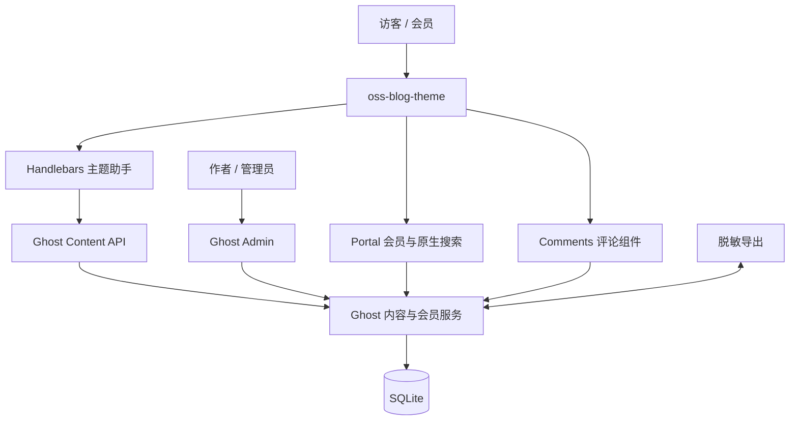

# 系统架构与修改边界

## 五个关键目录

| 目录 | 职责 | Git 策略 |
| --- | --- | --- |
| `theme/oss-blog-theme/` | 本人主题源码、单元测试与可安装包 | 跟踪源码，安装包现场生成 |
| `runtime/content/themes/` | Ghost 加载的主题目录 | 不跟踪，本地用目录链接指向源码 |
| `runtime/content/data/` | SQLite 运行数据 | 禁止提交 |
| `runtime/content/logs/` | 启动和运行日志 | 禁止提交 |
| `backup/` | 脱敏内容导出及恢复说明 | 只跟踪脱敏成品 |

## 请求路径

1. 浏览器请求文章详情页。
2. Ghost 将文章上下文交给 `post.hbs`。
3. 主模板渲染正文，再用 `get` 助手以当前 `primary_tag.slug` 查询公开文章。
4. 过滤器用 `id:-{{id}}` 排除当前文章，最多返回 3 条。
5. `post-card` 显示标签、摘要和 Ghost `reading_time` 结果。
6. Ghost 内容服务从 SQLite 读取数据；查询在服务端完成，浏览器不接触 Admin API 密钥。

## 允许与禁止修改

- 允许：主题 Handlebars、CSS、少量无状态 JavaScript、测试与文档。
- 禁止：Ghost `core/`、生成的依赖、SQLite 表结构、管理员密钥和会员隐私数据。

